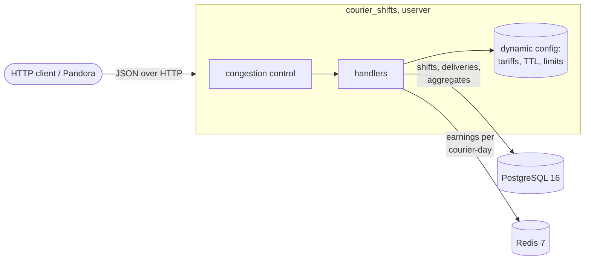

# courier-shifts-userver

A courier shift and earnings service in C++20 on [userver](https://github.com/userver-framework/userver):
PostgreSQL holds the invariants under concurrent writes, Redis caches earnings, tariffs live in dynamic
config, and congestion control sheds overload. The repo covers the whole loop around the code: testsuite and
unit tests, ASan/UBSan/TSan builds in CI, a Pandora load test on 2 pinned vCPUs, and one optimization found
in a perf flamegraph and measured before and after.

A personal project. It is not Yandex code and is not affiliated with Yandex. It only uses Yandex's
open-source tools (userver, yandex-taxi-testsuite, Pandora).

## Architecture



| Endpoint | What it does |
|---|---|
| `POST /v1/couriers` | create a courier |
| `POST /v1/shifts` | book a shift `[starts_at, ends_at)`, 409 if it overlaps another shift of the courier |
| `POST /v1/shifts/{id}/cancel` | cancel (idempotent) |
| `GET /v1/couriers/{id}/shifts?from&to` | list shifts |
| `POST /v1/shifts/{id}/assignments` | record a delivery; 409 for a duplicate order or one outside an active shift |
| `GET /v1/couriers/{id}/earnings?from&to` | earnings breakdown per shift, in integer cents |

Code: [`src/handlers.cpp`](src/handlers.cpp) (API, SQL, cache), [`src/earnings.cpp`](src/earnings.cpp)
(pay rules, dynamic config keys), [`postgresql/schemas/db.sql`](postgresql/schemas/db.sql),
[`configs/static_config.yaml`](configs/static_config.yaml).

- **Earnings** = hours x rate + deliveries x fee + km x rate, times a per-zone multiplier. Every part is
  rounded down to a cent. Rates live in the `COURIER_TARIFFS` dynamic config, so they change without a
  restart; testsuite overrides them per test.
- **Cache**: the courier's aggregated work per UTC day of shift start, `earnings:{courier}:<day>`. A read is
  one `MGET` over the days in the window. Missing days come from one range query and are stored with
  `SET EX`. A write deletes only the day it touches. Money is computed per request, so a tariff change needs
  no cache flush. The cache is best effort: when Redis is down, the service reads from the database.
- **Congestion control** is on in production config (`CPU_LIMIT=2c`, `USERVER_RPS_CCONTROL_ENABLED`),
  and `CC_ENABLED=false` turns it off for capacity runs.

## Invariants under concurrent writes

*A courier's shifts never overlap.* The invariant lives in the database, not in the handler:

```sql
CONSTRAINT shifts_no_overlap EXCLUDE USING gist (courier_id WITH =, period WITH &&)
    WHERE (cancelled_at IS NULL)
```

The first version checked overlaps in the handler (`SELECT EXISTS`, then `INSERT`).
[`tests/test_race.py`](tests/test_race.py) sends 16 concurrent overlapping requests for one courier, 10
rounds, and requires exactly one 201. Against that version it accepted 4 overlapping shifts in one round
([`docs/race-before-constraint.txt`](docs/race-before-constraint.txt)).

With the constraint in place, the same test under TSan found a second problem. Concurrent inserts wait for
each other's uncommitted rows while checking the constraint, and PostgreSQL aborts some of them with
`40P01 deadlock detected`, which surfaced as 500. Retrying on 40P01 did not help: with 16 contenders the
losers kept deadlocking among themselves. The insert now takes `pg_advisory_xact_lock(courier_id)` in a CTE
of the same statement. That orders writers of one courier at the cost of no extra round trip, and the loser
sees the committed row and gets a clean 409.

A delivery takes `FOR SHARE` on its shift row, so a concurrent cancel cannot slip in between the check and
the insert.

## Tests and CI

```bash
make test PRESET=release   # or asan (Debug, ASan + UBSan, no recover) or tsan
```

- 22 testsuite tests ([`tests/`](tests/)): API validation, overlaps, deliveries, earnings math, cache
  invalidation and hits, per-day invalidation, per-test dynamic config, and the race above.
- 8 unit tests of the pay rules and tariff parsing ([`src/earnings_test.cpp`](src/earnings_test.cpp)).
- The sanitizer presets build userver itself with the same flags (934 translation units with
  `-fsanitize=address,undefined`). Unit and testsuite tests run under each preset.
- TSan in Docker needs `--security-opt seccomp=unconfined`, because TSan re-execs itself with
  `ADDR_NO_RANDOMIZE`. [`tsan.suppressions.txt`](tsan.suppressions.txt) is userver's own list plus two
  narrow entries for reports inside userver (shutdown path, Redis standalone topology). None of them involve
  this service's code; the details are in the file. 40 consecutive local TSan runs of the suite were clean
  at `c92b4f8`, and every later change passed TSan as well.
- GitHub Actions runs `release`, `asan` and `tsan` on x86_64 ([`.github/workflows/ci.yml`](.github/workflows/ci.yml)).

## Load test

```bash
make bench LABEL=mylabel   # build, start the stand, seed, run every profile, write results/mylabel/
```

**Hardware.** Apple M4 Max laptop (12 performance + 4 efficiency cores). Docker runs in a colima 0.10.3
Apple Virtualization VM: 8 vCPU, 16 GB RAM, Ubuntu 24.04.4, kernel 6.8.0-117, **aarch64**. The VM has
no PMU, so perf samples on `cpu-clock`. CPU sets inside the VM:

| container | vCPUs | notes |
|---|---|---|
| service | 2 (`cpuset 0,1`) | 2 main worker threads, `CPU_LIMIT=2c` |
| PostgreSQL 16 | 3 | data in tmpfs, `synchronous_commit=off`, pool of 32 connections |
| Redis 7 | 1 | no persistence |
| Pandora 0.6.2 | 2 | open model, 2000–4000 instances, 1 s response timeout |

**Data and mix.** The seed has 10,000 couriers, 14 days with one 12 h shift a day each (140k shifts), and
1.4M deliveries. The request mix is 60% earnings for one day, 20% one-week shift lists, 15% new deliveries
and 5% new shifts ([`loadtest/gen_ammo.py`](loadtest/gen_ammo.py)). 409 counts as a correct answer;
errors are 429, 5xx and network errors or timeouts. Each step skips its first 5 s and last 2 s.

### Capacity, congestion control off (current code)

Two interleaved runs with the same host load ([`results/ladder-repeats/`](results/ladder-repeats/)):

| offered RPS | answered RPS | p50, ms | p99, ms | errors |
|---:|---:|---:|---:|---:|
| 4 000 | 4 036 / 4 042 | 0.33 / 0.33 | 0.60 / 0.60 | 0 / 0 |
| 8 000 | 8 071 / 8 084 | 0.23 / 0.22 | 0.53 / 0.51 | 0 / 0 |
| 12 000 | 12 108 / 12 126 | 0.21 / 0.22 | 0.72 / 0.93 | 0 / 0 |
| 16 000 | 16 143 / 16 170 | 0.22 / 0.25 | 4.02 / 3.77 | 0 / 0 |
| 20 000 | 20 088 / 20 211 | 0.27 / 0.32 | 6.25 / 7.31 | 0 / 0 |
| 24 000 | 24 215 / 24 259 | 0.46 / 0.57 | 8.78 / 9.27 | 0 / 0 |
| 28 000 | 28 263 / 28 365 | 0.80 / 0.77 | 10.86 / 10.12 | 0.01% / 0 |
| 32 000 | 32 289 / 32 352 | 1.15 / 0.98 | 14.57 / 14.51 | 0 / 0 |

Answered RPS can exceed offered RPS by about 1%: Pandora sends catch-up bursts after a scheduling hiccup.

### Error share against load beyond capacity

At 2 vCPUs the service saturates (CPU ≈1.95 of 2 cores) between 32k and 40k RPS
([`results/ladder-repeats/high-*`](results/ladder-repeats/)):

| offered RPS | baseline, CC off | current, CC off | current, CC on |
|---:|---|---|---|
| 32 000 | 30 541 ok, 6.1% 5xx, p99 35 ms | 32 072 ok, 0.8% 5xx, p99 26 ms | 20 028 ok, 38% 429, p99 22 ms |
| 36 000 | 9 673 ok, 74% 5xx, p99 313 ms | 31 400 ok, 14% 5xx, p99 97 ms | 13 464 ok, 63% 429, p99 23 ms |
| 40 000 | 6 235 ok, 84% 5xx, p99 652 ms | 16 877 ok, 58% 5xx, p99 345 ms | 8 813 ok, 78% 429, p99 24 ms |
| 48 000 | 2 509 ok, 95% errors | 1 816 ok, 96% errors | 3 812 ok, 92% 429, p99 24 ms |

Without congestion control, overload ends in congestion collapse. The PostgreSQL pool queue overflows
(`Wait queue size exceeded`), and answered RPS falls far below capacity. With CC, the server returns 429
early: no 5xx, and p99 stays near 23 ms. The default `USERVER_RPS_CCONTROL` policy over-sheds on this VM,
though. It keeps lowering the limit while CPU sits at 1.44 of 2 cores. In one earlier run on a busy host,
CC shed requests at 2k RPS, triggered by VM scheduling jitter
([`results/cc-busy-host`](results/cc-busy-host/)). Tuning the policy is the next step.

## Optimization from the flamegraph

**Finding.** In the baseline profile at a constant 12k RPS
([`results/baseline/flamegraph.svg`](results/baseline/flamegraph.svg)), the earnings handler took 19% of
service CPU. Most of that was a PostgreSQL round trip plus `HSET` + `EXPIRE`, which happen only on a cache
miss. Redis counters confirmed it: 431,722 `HGET`, but 358,279 refills, a 17% hit rate. The cache was a
hash per courier, and every delivery dropped all cached periods of that courier, which happened every few
seconds.

**Fix** (commit `a57a192`). Cache work per courier-day and invalidate only the affected day. A read is one
`MGET`, a refill is `SET EX`, and money is computed per request.

**Result**, with the same stand and load (a constant 12k RPS for 60 s, 3 runs each,
[`results/baseline`](results/baseline/) vs [`results/day-cache`](results/day-cache/)):

| | before | after | change |
|---|---:|---:|---:|
| service CPU at 12k RPS, cores | 1.325 / 1.315 / 1.325 | 1.170 / 1.148 / 1.166 | **−12%** |
| p50 / p99 at 12k RPS, ms | 0.39 / 1.73–3.48 | 0.23–0.24 / 1.00–1.58 | p50 −40% |
| GetEarnings in the profile, cores | 0.28 (19.2% of 1.44) | 0.16 (13.3% of 1.18) | −43% |
| cache hit rate | 17% | 60% | |
| Redis commands on the read path | 1,148,280 | 605,206 | −47% |
| PostgreSQL earnings queries | 358,279 | 173,484 | −52% |
| highest step without collapse (CC off) | 32k | 36k (31.4k answered) | |

Details: [`results/day-cache/redis-and-pg.txt`](results/day-cache/redis-and-pg.txt).

## Bugs the tests and the stand found

1. The handler's overlap check let 4 of 16 concurrent overlapping shifts through. Fixed with the exclusion
   constraint.
2. Exclusion-constraint deadlocks (40P01) came back as 500. Fixed with a per-courier advisory lock.
3. The service did not start outside testsuite (`http-client` depended on a testsuite-only component).
4. `CPU_LIMIT=2` is silently ignored by userver (it wants `2c`), which put congestion control in fake mode.
   The root cause is in userver itself, see [Upstream fix in userver](#upstream-fix-in-userver).
5. The default `nofile=1024` in the container gave `EMFILE` and a crash under thousands of connections.

## Upstream fix in userver

Tracing bug 4 led to a bug in userver's `hostinfo::CpuLimit()` (v2.16 to v3.2 and `develop`). Since the cgroup v2
fallback it returns 0 instead of "no limit", so `IsInRtc()` is always true. Congestion control with the
default `only-rtc: true` then never refuses to start without a CPU limit and silently runs in fake mode.
The same code truncates a fractional cgroup quota: `--cpus=1.5` becomes 1 core, `--cpus=0.5` becomes 0.

The fork branch [`chipontix/userver@fix-hostinfo-cpu-limit`](https://github.com/chipontix/userver/tree/fix-hostinfo-cpu-limit)
has a regression test (commit `800c60d46`, both cases fail) and the fix (commit `c4bc0dc6a`, both pass, and
so does the whole `userver-universal-unittest`). Test output:
[`results/upstream-cpu-limit/`](results/upstream-cpu-limit/). The problem, how to reproduce it, the
contribution rules and the PR text are in [`UPSTREAM-PR.md`](UPSTREAM-PR.md). The PR is not opened yet.

This service is not affected with its current config (`CPU_LIMIT=2c` and `only-rtc: false`), so it stays on
userver 3.2.

## Reproduce

Requirements: Docker (with compose) and python3. Everything else runs in the `courier-dev` image
([`docker/dev.Dockerfile`](docker/dev.Dockerfile)).

```bash
make image && make test PRESET=release
make bench LABEL=mine
```

## Limitations

- The benchmark numbers are from an **aarch64** VM on a laptop, not from dedicated x86 hardware. The same
  `make bench` runs unchanged on an x86_64 Linux host. Absolute RPS will differ, and so will the relative
  gains, though the latter should change less. Perforator supports only x86-64, so the profiles were taken
  with perf.
- Other workloads were running on the host (load average 4–6 during the reported runs). Every comparison
  ran back to back or interleaved, and repeats are published.
- A reader that queries the database before a concurrent write can store a stale day after that write's
  invalidation. The entry lives until the TTL (60 s by default). The fix is to version the day key, noted in
  the code.
- The optional YDB backend was not built: `ydbplatform/local-ydb` ships only for amd64, and running it under
  emulation would make any measurement meaningless.

## How it was built

The code, tests and documentation in this repository, and the userver fix in the fork, were written by the
AI coding agent Claude Code (Anthropic), with Rabiya setting the task and directing the work: she chose the
problem and the stack and set the requirements. The commits are under her account.

## License

Apache-2.0. [`cmake/DownloadUserver.cmake`](cmake/DownloadUserver.cmake) comes from userver's
`service_template` (Apache-2.0), and [`cmake/get_cpm.cmake`](cmake/get_cpm.cmake) from CPM.cmake (MIT).
